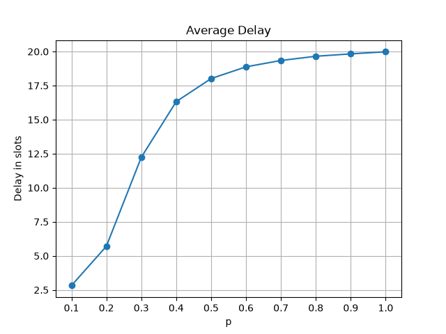
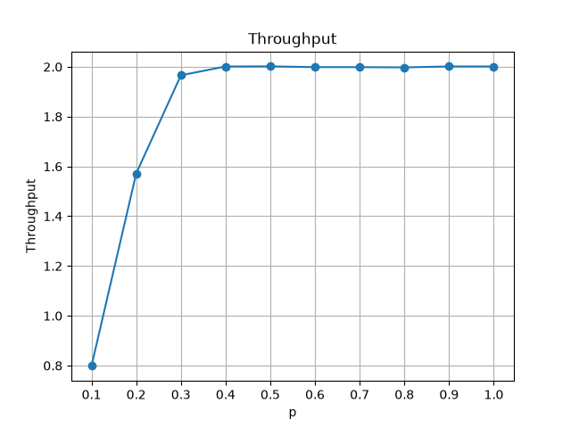
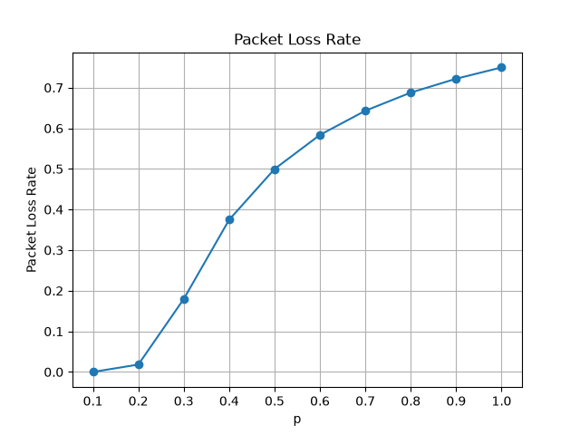

# WDM-Optical-Network-Simulator
Discrete-time Python simulator evaluating average packet delay,throughput,and packet loss rate in an 8-station,4 wavelength WDM optical network.

| `p`   | `Average Delay` | `Throughput` | `Packet Loss Rate`|
|:----|:-------------:|-------|---:|
| 0.1 |     2.82      | 0.799 | 0.0001|
 | 0.2 |     5.70      | 1.571 |0.0182|
 | 0.3 |     12.24     | 1.966 |0.1797|
| 0.4 |     16.32     | 2.001 | 0.3748|
 | 0.5 |     18.02     |2.002 | 0.4997|
 | 0.6 |     18.88     |1.999 | 0.5837|
 | 0.7 |     19.35     |1.999 | 0.6431|
 | 0.8 |     19.66     |1.998 | 0.6878|
 | 0.9 |     19.83     |2.002 | 0.7220|
 | 1.0 |     19.98     |2.001 | 0.7498|
### 1. Average Packet Delay

* **Low Load (p=0.1):** Average delay starts low at `2.82` slots , as station
queues remain mostly empty and wavelength collisions rarely occur.
*  **Transition Region(p ≥ 0.5):** Delay increases sharply (from `5.70` to `16.32` slots) as
incoming traffic outpaces the service rate and packets accumulate in the FIFO buffers.
* **Saturation ({p ≥ 0.5):** Delay converges asymptotically to an upper bound of **20 slots**, reaching `19.98` slots at p=1.0.
Under saturation , each 5-packet buffer stays continuously full.Since two stations share each wavelength with a transmission probability of 0.5 each the
probability of successful transmission per wavelength is 0.25
### 2. Network Throughput

* **Low Load (p ≤ 0.2):** Throughput scales almost linearly—rising from `0.799` packets/slot at p = 0.1 to `1.571` packets/slot at p = 0.2—since the network successfully serves nearly all arriving packets.
* **Saturation (p ≥ 0.4):** Throughput plateaus at **2.0 packets/slot** (`~1.998–2.002` across p \in [0.4, 1.0]).
Each station is shared by 2 stations.Since both transmit with probability of 0.5,a successful transmission occurs when one transmit and the other remains silent.This gives a success probability of 0.5
per wavelength.We have 4 wavelengths so the `maximum Throughput across the network is 2 packets per slot` 

### 3. Packet Loss Rate

* **Low Load (`p ≤ 0.2`):** Packet loss is negligible (`0.0001` at `p = 0.1` and `0.0182` at `p = 0.2`), because the per-station arrival rate remains below the maximum service capacity of `0.25` packets/slot.
* **Congestion (`p > 0.25`):** Once `p` exceeds `0.25`, the finite 5-packet buffers overflow frequently. The loss rate climbs rapidly to `0.4997` (~50%) at `p = 0.5` and peaks at `0.7498` (~75%) at `p = 1.0`.
At `p = 1.0`, 8 packets arrive across the network every slot, an average of 2 are successfully transmitted, and the remaining 6 are dropped, matching the theoretical limit of `6 / 8 = 0.75`.